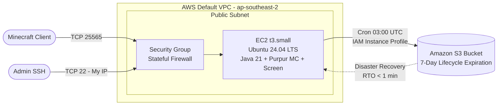

# Automated Minecraft Server & Disaster Recovery Pipeline on AWS

A production-inspired cloud infrastructure and DevOps automation project deploying a dedicated **Purpur Minecraft (1.21)** server on **AWS EC2**, featuring automated consistent backups to **Amazon S3**, **IAM Least-Privilege security**, **FinOps lifecycle policies**, and verified **Disaster Recovery (DR)** workflows.

---

## Architecture Diagram



---

## Key Engineering Highlights

* **Compute & Runtime Optimization:** Deployed on AWS EC2 (`t3.small`, 2 vCPU, 2 GiB RAM) running Ubuntu 24.04 LTS and OpenJDK 21, utilizing GNU `screen` for detached background session management and tuned JVM flags (`-Xms1024M -Xmx1536M`).
* **Network Hardening:** Configured AWS VPC Security Groups following the Principle of Least Privilege—restricting SSH (Port `22`) strictly to the administrator's CIDR while exposing game traffic on TCP Port `25565`.
* **Keyless Cloud Authentication (IAM):** Eliminated hardcoded AWS credentials by attaching a custom **IAM Role** (`EC2-Minecraft-S3-Role`) scoped exclusively to target S3 bucket actions (`PutObject`, `GetObject`, `ListBucket`, `DeleteObject`).
* **Data-Consistent Live Backup Pipeline:** Engineered an automated Bash script (`backup.sh`) scheduled via `crontab` that pauses world disk writes (`save-off` & `save-all`), archives world dimensions (`world`, `world_nether`, `world_the_end`), resumes auto-saving (`save-on`), uploads `.tar.gz` snapshots to S3, and purges local temporary files.
* **Cost Optimization (FinOps):** Enforced an S3 Lifecycle Rule (`ExpireOldBackups7Days`) to automatically expire backup archives older than 7 days, preventing unbounded storage growth.

---

## Repository Structure

```text
aws-automated-dr-for-minecraft/
├── iam/
│   └── s3-backup-policy.json    # Least-privilege IAM policy for EC2-to-S3 access
├── scripts/
│   ├── start.sh                 # Detached server startup script using GNU screen
│   └── backup.sh                # Automated live backup & S3 upload script
└── README.md
```

---

## Setup & Deployment Guide

### 1. Infrastructure Provisioning
1. Launch an **EC2 `t3.small`** instance (Ubuntu 24.04 LTS) in `ap-southeast-2` with a 20 GiB gp3 EBS volume.
2. Configure **Security Group** inbound rules:
   * `SSH (22)` -> Admin IP (`/32`)
   * `Custom TCP (25565)` -> `0.0.0.0/0`
3. Create a private **S3 Bucket** (Block all public access enabled) and attach a 7-day object expiration lifecycle rule.
4. Create an **IAM Role** for EC2 using `iam/s3-backup-policy.json` and attach it to the instance.

### 2. Server & Automation Configuration
```bash
# Install dependencies & AWS CLI v2
sudo apt update && sudo apt install -y openjdk-21-jre-headless screen unzip curl
curl "https://awscli.amazonaws.com/awscli-exe-linux-x86_64.zip" -o "awscliv2.zip"
unzip -q awscliv2.zip && sudo ./aws/install && rm -rf aws awscliv2.zip

# Deploy scripts and set execution permissions
chmod +x ~/minecraft-server/start.sh ~/minecraft-server/backup.sh

# Schedule daily automated backups at 03:00 UTC
(crontab -l 2>/dev/null; echo "0 3 * * * /home/ubuntu/minecraft-server/backup.sh >> /home/ubuntu/minecraft-server/backup.log 2>&1") | crontab -
```

---

## Disaster Recovery (DR) Drill & Results

To validate backup integrity and recovery readiness, a full data-loss simulation was executed:

1. **Failure Simulation:** Gracefully stopped the running Minecraft process and permanently deleted all world directories (`rm -rf world world_nether world_the_end`).
2. **Automated Restoration:** Queried the latest archive from S3 via AWS CLI, extracted world files back into the server directory, and restarted the instance runtime:
   ```bash
   LATEST_BACKUP=$(aws s3 ls s3://mc-server-backups-aey-2026/ | sort | tail -n 1 | awk '{print $4}')
   aws s3 cp "s3://mc-server-backups-aey-2026/${LATEST_BACKUP}" ~/minecraft-backups/
   tar -xzf ~/minecraft-backups/${LATEST_BACKUP} -C ~/minecraft-server/
   ~/minecraft-server/start.sh
   ```
3. **Outcome:**
   * **Recovery Time Objective (RTO):** `< 1 minute` (from archive retrieval to active port `25565` listener).
   * **Recovery Point Objective (RPO):** `24 hours` (configurable via Cron schedule).
   * **Data Integrity:** 100% of world terrain, player inventories, and server configurations restored with zero corruption.
